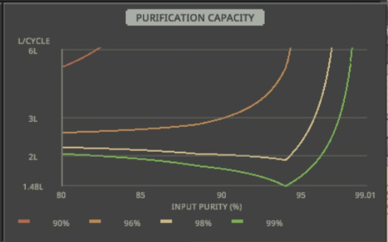
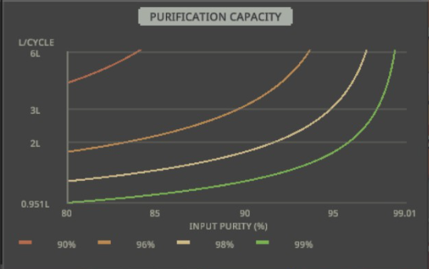

# ChemQOL

ChemQOL is a quality-of-life and rebalancing mod for **Probably Stolen**. It focuses on chemistry machines and liquids.

## Features

- 🧯 Heating Plate: Turns off when adding a liquid container.
- 🎯 Chem Finisher: Select the recipe that best matches an inserted container's ingredients.
- 🧪 Chem Finisher: Close the recipe selector after choosing a recipe.
- 🫗 Pour Liquids: While holding a liquid container (**use** not drag), scroll down to pour 10% of its capacity into the container under the cursor.
- 💧 Droppers: While holding a dropper, scroll up to draw 10% of its capacity from the container under the cursor.
- 🧪 Water Test Strips and Composition Spectrometer: Add the tested water purity to the container like the AquaScan does.
- 📈 Water Purifier: Show how much water of a given purity it can purify to the quality gates of 90, 96, 98, 99 and 99.9% purity.
- 📈 Water Purifier: Show the exact amount of the contained liquid it can process once its purity has been tested.
- 📊 Water Purifier: Re-balance the water purifier's capacity with a physically plausible model without the minimum at 94%.

| Original Water Purifier Capacity | Modified Water Purifier Capacity |
| - | - |
|  |  |
## Configuration

Enable the mod, then open its configuration panel from the Mods menu. All gameplay options but the rebalance are enabled by default; every feature can be toggled individually.

### Translations

Option labels are localized in English and German.

Machine Translations in French, Russian, Chinese, Japanese, Spanish, Brazilian Portuguese, Korean, Italian, and Polish.

## Installation

### Using prebuild binaries

Download the latest release archive `ChemQOL-*.zip` from the release section.

Unzip the file into `steamapps/common/Probably Stolen/Mods/de.simonding.chemqol`.
The folder `de.simonding.chemqol` needs to contain the file `ChemQOL.dll`.

### Build and Install from Source

On Linux, install the .NET SDK and GNU Make.

Run 

```sh
make install
```

in the projects root folder.

#### If you have a custom steam install location:

```sh
cp .env.example .env
```

Edit `.env` and set `GAME_DIR` to the directory containing `Probably Stolen_Data/Managed`. For example:

```make
GAME_DIR=/path/to/SteamLibrary/steamapps/common/Probably Stolen
```

## 简体中文（机器翻译）

ChemQOL 是一款为 **Probably Stolen** 中化学工作流程提供便利功能的模组。它主要改进化学设备和化学液体的处理，同时也提供一些可用于水的液体操作便利功能。

## 功能

- 安全断电：放入液体容器时自动关闭加热板。
- 放入容器后，自动选择与其中主要活性成分最匹配的化学制剂成型机配方。
- 选择配方后自动关闭化学制剂成型机的配方选择器。
- 双击液体容器以选中它，将鼠标悬停在另一个兼容容器上，然后向下滚动，将少量液体（最大容量的 10%）倒入其中。
- 双击移液器以选中它，将鼠标悬停在另一个兼容容器上，然后向上滚动，从中吸取少量液体。

## 配置

启用模组后，在“模组”菜单中打开它的配置面板。游戏功能默认全部启用；每项功能都可以单独关闭。

### 翻译

选项标签提供英语和德语翻译。

设备相关文本提供法语、俄语、中文、日语、西班牙语、巴西葡萄牙语、韩语、意大利语和波兰语翻译。

## 从源代码构建和安装

在 Linux 上安装 .NET SDK 和 GNU Make，然后配置游戏的安装目录。

如果 Steam 安装在自定义位置：

```sh
cp .env.example .env
```

编辑 `.env`，将 `GAME_DIR` 设置为包含 `Probably Stolen_Data/Managed` 的目录。例如：

```make
GAME_DIR=/path/to/SteamLibrary/steamapps/common/Probably Stolen
```

将模组构建并安装到游戏的 `Mods/de.simonding.chemqol` 目录：

```sh
make install
```
